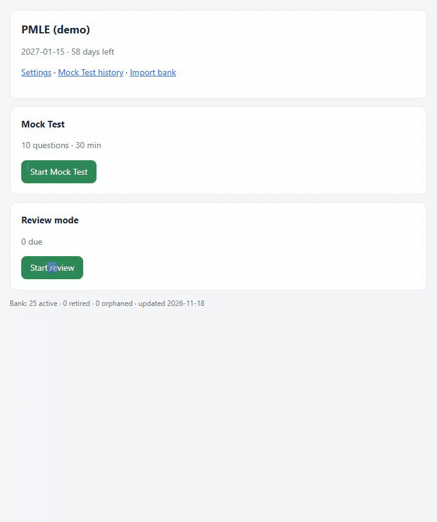
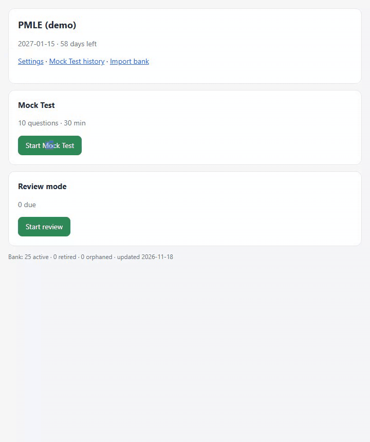
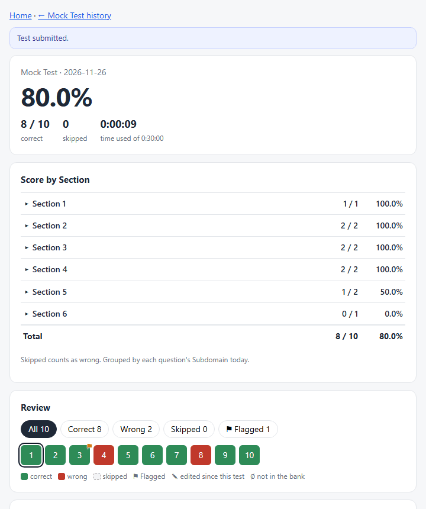
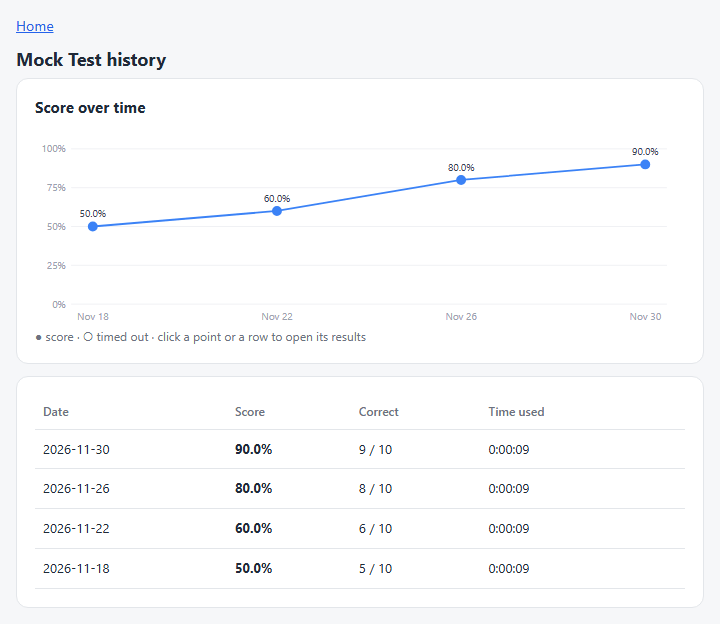
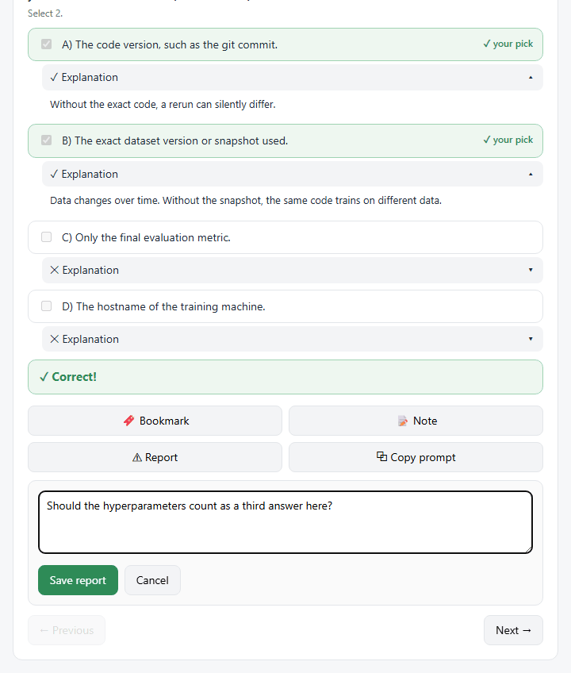
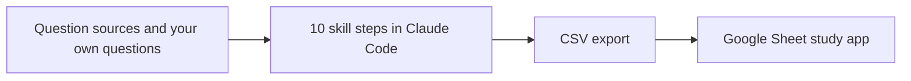
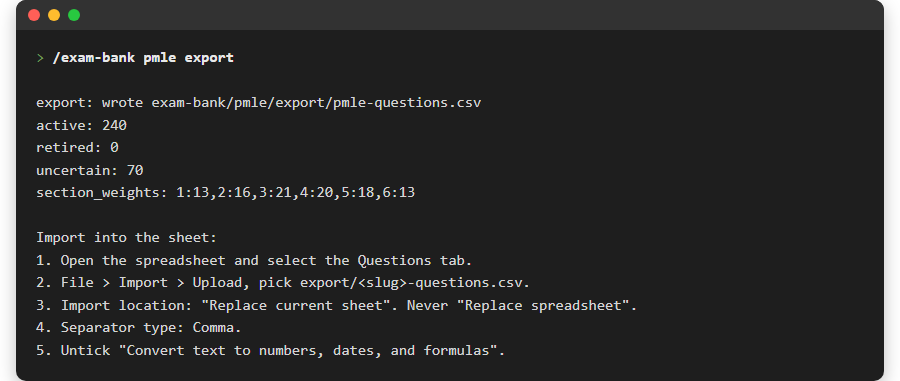
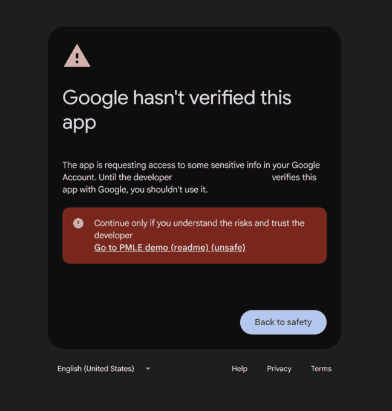
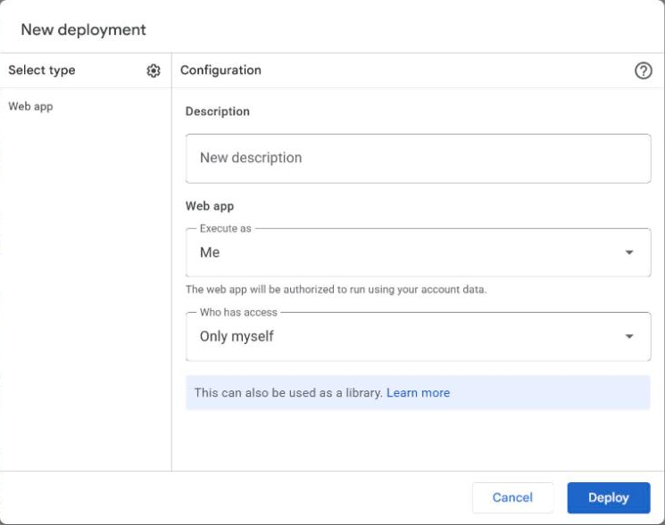

# GCP Exam Builder

[](LICENSE)
[](https://github.com/Gjandane/gcp-exam-builder/actions/workflows/check.yml)


Build your own Google Cloud certification question bank with Claude Code, then drill it in a free Google Sheets exam simulator.



Personal use only · Not affiliated with Google · [details](#7-notes-and-license)

| Review mode | Mock Test |
|---|---|
|  |  |
| Grade each answer at once and read why every choice is right or wrong. | Timed practice exam with flags, then submit. |

| Results by Section | History and Report loop |
|---|---|
|  |   |
| See which Sections need work. | Track every attempt, and report a bad question to get it re-checked. |

## How it works



The last step prints a summary like this:



## Try it in 5 minutes

No bank build and no Opus spend. Deploy the app with [Part 2](#4-part-2-deploy-the-study-app) steps 1 to 4. In step 5 import `docs/demo/demo-bank.csv` instead of the exported CSV. In step 6 use exam name `PMLE (demo)` and this line:

```text
section_weights: 1:13,2:16,3:21,4:20,5:18,6:13
```

Then practice. A new bank shows "0 due" in Review mode; "Start review" still opens every question.

If this helps you pass, a ⭐ helps others find it.

## Contents

- [1 Intro](#1-intro)
- [2 Prerequisites](#2-prerequisites)
- [3 Part 1: Build the Question bank](#3-part-1-build-the-question-bank)
- [4 Part 2: Deploy the study app](#4-part-2-deploy-the-study-app)
- [5 Upkeep](#5-upkeep)
- [6 Troubleshooting](#6-troubleshooting)
- [7 Notes and License](#7-notes-and-license)

## 1 Intro

GCP Exam Builder builds a Question bank for a Google Cloud certification exam and exports it as a CSV for a study app. Follow the two parts: "Build the Question bank" and "Deploy the study app". Keep the bank for personal use ([scope](docs/specs/0001-exam-bank-skill.md#scope)).

## 2 Prerequisites

Before starting, install or enable the following ([prerequisites](docs/specs/0001-exam-bank-skill.md#2-prerequisites)):

- Claude Code with access to the `opus` and `sonnet` aliases in `models.yaml`.
- git.
- Python 3.11 or newer. Check with `python --version` in bash or PowerShell.
- Node 22 or newer, then run this in bash or PowerShell:

  ```bash
  npm i -g @google/clasp
  ```

- A Google account. Turn on the Apps Script API at [Apps Script user settings](https://script.google.com/home/usersettings).

A full build runs many `opus` subagent sessions for answers, explanations, augmentation and re-checks. Usage grows with bank size; lower it by editing task aliases and effort in `exam-bank/config/models.yaml` ([cost and prerequisites](docs/specs/0001-exam-bank-skill.md#2-prerequisites), [config](docs/specs/0001-exam-bank-skill.md#config)).

## 3 Part 1: Build the Question bank

### Install

Run in bash or PowerShell ([install](docs/specs/0001-exam-bank-skill.md#repo-layout-and-install)):

```bash
git clone https://github.com/Gjandane/gcp-exam-builder.git
cd gcp-exam-builder
pip install -r requirements.txt
playwright install chromium
```

Open Claude Code in the cloned folder.

### Configure

In bash:

```bash
mkdir -p exam-bank/config/exams
cp .claude/skills/exam-bank/templates/models.example.yaml exam-bank/config/models.yaml
cp .claude/skills/exam-bank/templates/exams/pmle.example.yaml exam-bank/config/exams/pmle.yaml
```

<details class="more">
<summary class="more">PowerShell</summary>

```powershell
New-Item -ItemType Directory -Force exam-bank/config/exams
Copy-Item .claude/skills/exam-bank/templates/models.example.yaml exam-bank/config/models.yaml
Copy-Item .claude/skills/exam-bank/templates/exams/pmle.example.yaml exam-bank/config/exams/pmle.yaml
```

</details>

Edit `enabled` per source in `exam-bank/config/exams/pmle.yaml`, and `alias` and `effort` per task in `exam-bank/config/models.yaml`. Read each source's terms before leaving it enabled ([config](docs/specs/0001-exam-bank-skill.md#config)).

### Set permissions

In Claude Code, run:

```text
/exam-bank pmle
```

Paste the permissions that `setup` prints into `.claude/settings.local.json`, merging them with any existing settings ([permissions](docs/specs/0001-exam-bank-skill.md#permissions-printed-by-setup)).

### Run to export

Start a fresh Claude Code session, run `/exam-bank pmle`, read the summary, then start a fresh session for the next command it prints. Repeat until `export` is done ([invocation and routing](docs/specs/0001-exam-bank-skill.md#invocation-and-routing)).

| Step | What it does | What you do |
|---|---|---|
| [`setup`](docs/specs/0001-exam-bank-skill.md#step-1-setup) | checks config and tools | paste the printed permissions |
| [`scrape`](docs/specs/0001-exam-bank-skill.md#step-2-scrape) | reads the Curated sites | log in and solve any CAPTCHA in the browser window it opens |
| [`llm-scrape`](docs/specs/0001-exam-bank-skill.md#step-3-llm-scrape) | reads the other source pages | nothing |
| [`intake`](docs/specs/0001-exam-bank-skill.md#step-4-intake) | reads your own questions | before this step, write them in `exam-bank/pmle/given/*.md`, using [the given-question format](.claude/skills/exam-bank/templates/given-example.md) |
| [`merge`](docs/specs/0001-exam-bank-skill.md#step-5-merge) | removes duplicates, assigns IDs | nothing |
| [`tag`](docs/specs/0001-exam-bank-skill.md#step-6-tag) | sets each question's Subdomain | nothing |
| [`answers`](docs/specs/0001-exam-bank-skill.md#step-7-answers) | fills missing answers and every Uncertain answer | nothing |
| [`explanations`](docs/specs/0001-exam-bank-skill.md#step-8-explanations) | writes an explanation per choice | nothing |
| [`augment`](docs/specs/0001-exam-bank-skill.md#step-9-augment) | creates questions for thin Subdomains | answer yes or no to the gap table, once |
| [`export`](docs/specs/0001-exam-bank-skill.md#step-10-export) | writes the CSV | import it using [Part 2](#4-part-2-deploy-the-study-app) |

Find the CSV at `exam-bank/pmle/export/pmle-questions.csv` ([export](docs/specs/0001-exam-bank-skill.md#step-10-export)).

For the optional Study guide, run `/exam-bank pmle study-guide` ([Study guide route](docs/specs/0001-exam-bank-skill.md#study-guide-route)).

## 4 Part 2: Deploy the study app

One path: clasp.

**Step 1: create the sheet and push the code.** Run in bash or PowerShell:

```bash
cd app
clasp login
clasp create-script --type sheets --title "PMLE study"
git checkout -- appsscript.json
clasp push --force
```

`clasp create-script` makes a new Google Sheet with the script bound to it, prints both URLs, and overwrites `appsscript.json` with a default manifest, so `git checkout -- appsscript.json` restores the repo's. Plain `clasp push` prints "Skipping push." in a non-interactive shell because the remote manifest differs, so use `--force`.

**Step 2: authorize.** Open the new sheet and reload it, so the "Study app" menu appears. Click "Study app" > "Open study app". Google shows the dialog "Authorization required: A script attached to this document needs your permission to run." Click OK. A Google popup opens. It shows "Google hasn't verified this app". Click the link `Go to <sheet name> (unsafe)`; there is no "Advanced" link. The next screen, "`<sheet name>` wants access to your Google Account", lists two permissions with unticked boxes. Tick "Select all", scroll down, click "Continue". The popup closes by itself; click "Open study app" again. If you close the popup before the end, "Open study app" shows "Authorization required" again; click OK and finish the popup this time. This warning is expected for a script you own and run yourself.



**Step 3: deploy.** In the sheet open Extensions > Apps Script. Click Deploy > New deployment. The type "Web app" is already selected, "Execute as" reads "Me (`<your email>`)" and "Who has access" reads "Only myself". Click Deploy. If step 2 was skipped, the dialog first says "The Web App requires you to authorize access to your data." with an "Authorize access" button, which opens the same Google screens. The dialog then shows the Deployment ID and the web app URL ending in `/exec`.



**Step 4: first open.** Open the web app URL the Deploy dialog showed. The app creates its tabs and shows the import steps. From now on "Study app" > "Open study app" in the sheet links to the same URL. Before this first open that menu item cannot know the URL, and its dialog says so.

**Step 5: import the bank.**

```text
Import into the sheet:
1. Open the spreadsheet and select the Questions tab.
2. File > Import > Upload, pick exam-bank/pmle/export/pmle-questions.csv.
3. Import location: "Replace current sheet". Never "Replace spreadsheet".
4. Separator type: Comma.
5. Untick "Convert text to numbers, dates, and formulas".
```

Then reload the app.

**Step 6: Settings.** Enter the exam name and exam date. Paste the `section_weights` line that `export` printed, `section_weights:` prefix included. Save. Saving takes about 10 seconds, with the button greyed out and no other sign.

Study data lives in the sheet's other tabs. Never import with "Replace spreadsheet".

Links: [Bank check](docs/specs/0002-study-app.md#bank-check) for a refused bank, [Settings screen](docs/specs/0002-study-app.md#settings-screen) for the field rules.

## 5 Upkeep

<details class="more">
<summary class="more">Upkeep steps</summary>

- Re-check Reports: in the spreadsheet, open the `Reports` tab, choose File > Download > Comma-separated values, and save the CSV into `exam-bank/pmle/reports/`. In fresh Claude Code sessions, run `/exam-bank pmle recheck`, then `/exam-bank pmle export`. Import using [Part 2](#4-part-2-deploy-the-study-app) ([Recheck route](docs/specs/0001-exam-bank-skill.md#recheck-route)).
- Update the skill: run `git pull` in the cloned folder, in bash or PowerShell ([install and updates](docs/specs/0001-exam-bank-skill.md#repo-layout-and-install)).
- Add another exam: replace `your-exam` below with your chosen slug. In bash:

  ```bash
  cp .claude/skills/exam-bank/templates/exams/pmle.example.yaml exam-bank/config/exams/your-exam.yaml
  ```

  In PowerShell:

  ```powershell
  Copy-Item .claude/skills/exam-bank/templates/exams/pmle.example.yaml exam-bank/config/exams/your-exam.yaml
  ```

  Fill that file from the official exam guide: the slug, name, guide version, Subdomains, Section weights and sources. Run `/exam-bank your-exam` with the same chosen slug ([exam config](docs/specs/0001-exam-bank-skill.md#the-exam-file), [skill upkeep](docs/specs/0001-exam-bank-skill.md#5-upkeep-skill-side)).

- Re-import the bank: after any new export, repeat [Part 2](#4-part-2-deploy-the-study-app) step 5. Study history is kept ([Sheet tabs](docs/specs/0002-study-app.md#sheet-tabs)).
- Update the app code: run `git pull`, then in bash or PowerShell:

  ```bash
  cd app
  clasp push --force
  clasp list-deployments
  clasp update-deployment <deploymentId>
  ```

  Pushed code reaches the app only after `update-deployment`. `list-deployments` prints one `<deploymentId> @<version>` line per deployment plus an `@HEAD` line; use the ID with a version number. `update-deployment` moves it to a new version under the same ID, so the web app URL does not change.
- Move to another Google account: in the sheet, File > Make a copy. The script and the study history come along. Then repeat [Part 2](#4-part-2-deploy-the-study-app) steps 2 to 4 in the copy.
- Add another exam, app half: use one clasp settings file per exam, `app/.clasp-<slug>.json`, and `--project <absolute path>` on every clasp command. `create-script --project` fails until the file exists, so create it with `{}` first. A relative path breaks every later command with "srcDir escapes project root", so use the absolute path. In PowerShell:

  ```powershell
  cd app
  '{}' | Set-Content .clasp-pde.json
  $p = (Resolve-Path .clasp-pde.json).Path
  clasp --project $p create-script --type sheets --title "PDE study"
  git checkout -- appsscript.json
  clasp --project $p push --force
  ```

  This was tested in PowerShell on Windows only; a Git Bash path such as `$PWD/.clasp-pde.json` still failed with "srcDir escapes project root". Then repeat [Part 2](#4-part-2-deploy-the-study-app) steps 2 to 6 in the new sheet. One code folder serves every exam sheet.

</details>

## 6 Troubleshooting

<details class="more">
<summary class="more">Troubleshooting fixes</summary>

- `setup` stops on a set environment variable or a missing tool: unset the named variable or install the named tool, then rerun `/exam-bank pmle` ([Step 1](docs/specs/0001-exam-bank-skill.md#step-1-setup)).
- `state.md` shows `waiting on user`: do the action it names, then rerun the command ([Step 2](docs/specs/0001-exam-bank-skill.md#step-2-scrape)).
- `failed` Batches: run the same command again. Check `exam-bank/pmle/state.md` for questions retired after validation rejected them in two failed runs ([dispatch](docs/specs/0001-exam-bank-skill.md#dispatch)).
- A source shows `failed: robots` or another reason: write those questions in `exam-bank/pmle/given/` using [the given-question format](.claude/skills/exam-bank/templates/given-example.md) ([Step 3](docs/specs/0001-exam-bank-skill.md#step-3-llm-scrape), [intake](docs/specs/0001-exam-bank-skill.md#step-4-intake)).

- The app says a column "is not text": import again with "Convert text to numbers, dates, and formulas" unticked ([Bank check](docs/specs/0002-study-app.md#bank-check)).
- The app says its tabs are gone: in the sheet, File > Version history, restore the version from before the import ([Load sequence](docs/specs/0002-study-app.md#load-sequence)).
- "Google hasn't verified this app": expected for your own script. Click "Go to `<sheet name>` (unsafe)" ([Part 2](#4-part-2-deploy-the-study-app), step 2).
- Copy prompt shows a text box instead of copying: press Ctrl+C ([Copying](docs/specs/0002-study-app.md#copying)).
- The Settings screen opens on load: fix the marked field and save ([Settings screen](docs/specs/0002-study-app.md#settings-screen)).
- A code change does not show in the app: run `clasp update-deployment` ([Upkeep](#5-upkeep)).

</details>

## 7 Notes and License

- Keep the bank for personal use. Never publish the CSV, the sheet or `exam-bank/` ([notes](docs/specs/0001-exam-bank-skill.md#7-notes-and-license)).
- Read each source's terms of service before enabling it; fetching obeys `robots.txt` ([notes](docs/specs/0001-exam-bank-skill.md#7-notes-and-license)).
- Solve CAPTCHAs yourself in the browser window. No script bypasses them ([scrape](docs/specs/0001-exam-bank-skill.md#step-2-scrape)).
- Check Uncertain answers and use Report when an LLM-written answer looks wrong ([notes](docs/specs/0001-exam-bank-skill.md#7-notes-and-license), [Recheck route](docs/specs/0001-exam-bank-skill.md#recheck-route)).
- This project is not affiliated with Google. Exam names and guide text belong to their owners ([notes](docs/specs/0001-exam-bank-skill.md#7-notes-and-license)).
- License: MIT, see [LICENSE](LICENSE).
